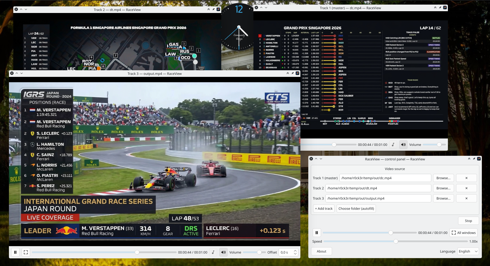

# RaceView

<p align="center">
  
</p>

Multi-track synchronized video player built with **Qt6** and **libmpv**.

RaceView was made for watching **sports events** — above all **Formula 1**. Put
the TV broadcast next to the onboard cameras, a team / data feed or a second
angle, and watch them all at the same time, perfectly in step. The same idea
works for any situation where you need several recordings of one moment side by
side: other sports, concerts, multi-camera or security footage, A/B takes.

Select **multiple files** and RaceView opens each one in its **own window**, then
keeps every track **synchronized** against a single *master* track — with
per-track audio selection, time offset and volume.

Version: **0.99.4**

## Download

Prebuilt binaries for every release — a Linux **AppImage** and a Windows
**x86_64 zip** — are attached to the
[latest release](https://github.com/r0ck3r/RaceView/releases/latest).

## Features

- **Multi-track playback** — any number of video tracks; track 1 is the master,
  the rest are slaved to its clock.
- **Per-track controls** — play/pause, audio track, mute, volume, and a time
  offset for non-master tracks.
- **Audio track selection** — compact button opens a modal dialog listing all
  audio tracks (language / title / id).
- **Synchronized seeking** — global and per-track seek with a large on-screen
  OSD showing the target time and delta.
- **Fullscreen** — per window (double-click, `F`, or button) or all windows at
  once; floating auto-hiding control bar in fullscreen.
- **MPRIS / D-Bus** — `org.mpris.MediaPlayer2.raceview` for system media keys
  and desktop media widgets (KDE/GNOME).
- **Internationalization** — English source language with Russian, German,
  Spanish and French translations; language follows the system locale by
  default and can be switched in the UI.
- **Hardware decoding** — `hwdec=auto-copy` by default (overridable).

## Requirements

- CMake >= 3.16
- Qt6: `Widgets`, `OpenGLWidgets`, `DBus`, `LinguistTools`
- libmpv (client API) and its development headers
- A C++17 compiler

## Build

```sh
cmake -S . -B build
cmake --build build
```

The binary is produced at `build/raceview`. Translation files (`*.qm`) are
generated automatically during the build.

If your Qt6 / libmpv live in a non-standard prefix, adjust `DEPS_DIR` in
`CMakeLists.txt` (it points to `.deps/usr/usr` by default).

### Install

```sh
cmake --install build --prefix ~/.local
```

This installs the binary, the `.desktop` entry, the icon, and the translations.

## Usage

```sh
./build/raceview [file1] [file2] ...
```

Pass one or more video files. The first file is the master track. You can also
add tracks through the control panel after launch.

### Keyboard shortcuts (per video window)

| Key | Action |
| --- | --- |
| `Space` | Play / pause |
| `←` / `→` | Seek ∓5s (`Shift` = ∓60s) |
| `,` / `.` | Frame step back / forward |
| `↑` / `↓` | Volume up / down |
| `[` / `]` | Speed down / up |
| `F` | Toggle fullscreen |
| `Esc` | Exit fullscreen |
| `S` | Screenshot |

### Environment variables

| Variable | Meaning |
| --- | --- |
| `RACEVIEW_HWDEC` | Override `hwdec` (default `auto-copy`) |
| `RACEVIEW_HEADLESS` | Headless mode (`vo=null`), for testing |
| `RACEVIEW_DEBUG` | Verbose mpv logging |

## Configuration

Settings are stored via `QSettings` (`~/.config/raceview/raceview.conf` on
Linux):

- `language` — UI language (`en`, `ru`, `de`, `es`, `fr`); empty = system locale.
- `lastDir` — last folder used in file dialogs.

## Repository layout

```
src/            C++ sources
icons/          application icon (SVG)
docs/           screenshots (shown in this README)
test/           sample media (not tracked)
raceview.desktop  desktop entry
raceview_*.ts     translations (ru, de, es, fr)
resources.qrc     Qt resources
```

## License

RaceView is free software: you can redistribute it and/or modify it under the
terms of the **GNU General Public License** as published by the Free Software
Foundation, either version 3 of the License, or (at your option) any later
version (`GPL-3.0-or-later`). The full license text is in the
[`LICENSE`](LICENSE) file.

Copyright (c) 2026 r0ck3r — <https://github.com/r0ck3r>

RaceView links against **libmpv** (`GPL-3.0-or-later`) and **Qt 6**
(`LGPL-3.0`); the GPL applies to the combined work. See each upstream project
for its own license terms.
